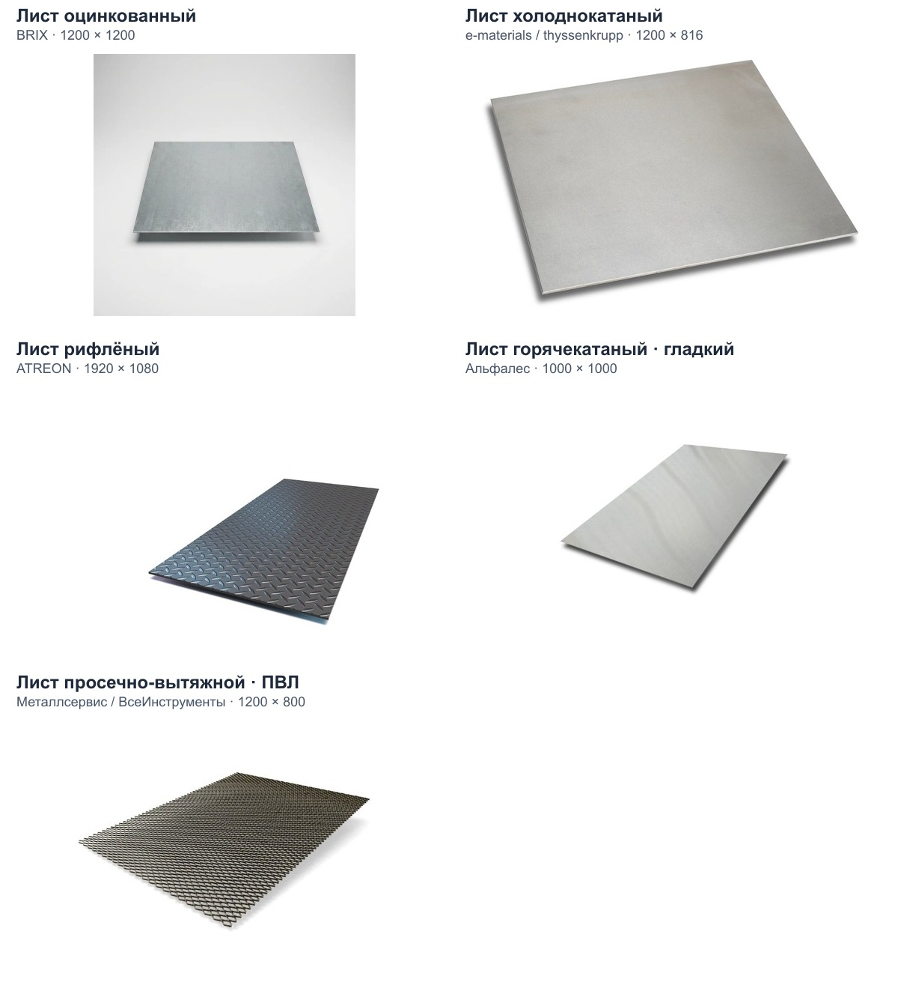

# Источники изображений «Листового проката»

Подборка от 04.11.2026. В проекте четыре подкатегории и 25 товаров. Для изображения продукции нужны пять групп: внутри горячекатаной подкатегории находятся три позиции ПВЛ.

Файлы сохранены для последующей подготовки размерных иллюстраций. К страницам сайта они пока не подключены. Числовые подписи не добавлялись.

| Группа | Источник | Разрешение файла | Файл | Позиций-кандидатов |
| --- | --- | --- | --- | --- |
| Лист оцинкованный | [BRIX](https://brix.uz/ru/product/galvanized-steel-sheet-100) | 1200 × 1200 | [galvanized-sheet.webp](galvanized-sheet.webp) | 3 |
| Лист холоднокатаный | [e-materials / thyssenkrupp](https://e-materials.pl/products/blacha-stalowa-2-mm-zimnowalcowana-dc01) | 1200 × 816 | [cold-rolled-sheet.jpg](cold-rolled-sheet.jpg) | 2 |
| Лист рифлёный | [ATREON](https://www.atreon.pl/blacha-ryflowana-stalowa-5mm/) | 1920 × 1080 | [chequered-steel-sheet.jpg](chequered-steel-sheet.jpg) | 4 |
| Лист горячекатаный · гладкий | [Альфалес](https://alfales.ru/catalog/metalloprokat/list-metall/list-2012502500-gk/) | 1000 × 1000 | [hot-rolled-sheet.jpg](hot-rolled-sheet.jpg) | 13 |
| Лист просечно-вытяжной · ПВЛ | [Металлсервис / ВсеИнструменты](https://www.vseinstrumenti.ru/product/prosechno-vytyazhnoj-list-metallservis-pvl-406-1200x300-mm-1237741-8352795/) | 1200 × 800 | [expanded-metal-sheet.jpg](expanded-metal-sheet.jpg) | 3 |

На e-materials выбран отдельный холоднокатаный лист (второй кадр галереи). Для остальных видов подходящих товаров в проверенных разделах и поиске не найдено, поэтому использованы дополнительные источники. Рифлёный алюминий e-materials исключён для стального листа.

## Проверить перед нанесением размеров

- Рифлёный лист ATREON показывает чечевичный рисунок. В проекте конкретный рисунок не указан; уточнить перед назначением всем четырём позициям.
- Фото ПВЛ относится к 406. Для двух ПВЛ 306 отдельно сверить форму ячеек; ширину/длину ячеек по фото не рассчитывать.
- Холоднокатаная группа имеет исторический slug list-ocynkovannyj и описание оцинковки, противоречащие названию. Данные в этой задаче сохранены; классификацию проверить до публикации подписей.
- Использовать размеры и массы конкретной позиции из проекта. Марки, нормы, цены и размеры доноров не переносить. Не воспроизводить будущую размерную схему как масштабный производственный чертёж.
- Самый большой файл — 1920 × 1080; минимальная длинная сторона — 1000 px. Размещение этих изображений на холсте 2400 × 1800 не создаст новых деталей фотографии.

## Отбор и сохранность

Выбраны изолированные изображения отдельных листов: без размерной разметки, посторонних предметов, видимых логотипов и водяных знаков; контур листа целиком в кадре. Ракурс, масштаб и фактура различаются — это исходники для макета, не готовая единая серия.

Исключены кадры только с углом листа, стопки, складские снимки, алюминиевые листы, кадр ОBI с перенаправлением на другую карточку и варианты малого разрешения при наличии более крупного подходящего файла. Альтернативы для исследования сохранены только в .tmp/sheet-photo-search/.

manifest.json содержит адреса страниц и файлов, SHA-256, фактические размеры изображений, ограничения и перечень текущих товаров для каждого кандидата. Все пять файлов скопированы без изменения байтов.

## Дополнительный исходник ATREON

По запросу владельца сохранён [отдельный лист без разметки](atreon-chequered-steel-sheet.png) — третий кадр [карточки листа 1×2 м, 4 мм](https://www.atreon.pl/blacha-ryflowana-1x2-m--grubosc-4-mm/). Фактическое разрешение — **1024 × 768 px**, формат PNG. [Опубликованный оригинал](https://www.atreon.pl/user/shop/orig/603-1_blacha-ryflowana-1x2-m--grubosc-4-mm_3.png?66d95af2) скопирован без перекодирования, обрезки и увеличения; контур, фактура и белые поля сохранены. Главный кадр этой карточки и второй кадр содержат размерную схему, поэтому для подготовки наших подписей выбран третий.

Этот файл записан в `additionalImages` манифеста и пока не подключён к сайту. Ранее выбранная иллюстрация ATREON 1920 × 1080 сохранена. Размеры и марка товара источника не задают характеристики наших позиций.

## Дополнительные варианты рифлёного стального листа

[Подборка из пяти изображений](chequered-alternatives/README.md) содержит ещё четыре варианта с целым контуром и крупный кадр фактуры MORIS 2560 × 1920. Исходники сохранены без увеличения и ретуши; отдельно указаны иллюстрации, образец, ограничения ракурса и разрешения. Подборка предназначена для выбора перед разметкой и не подключена к сайту.
