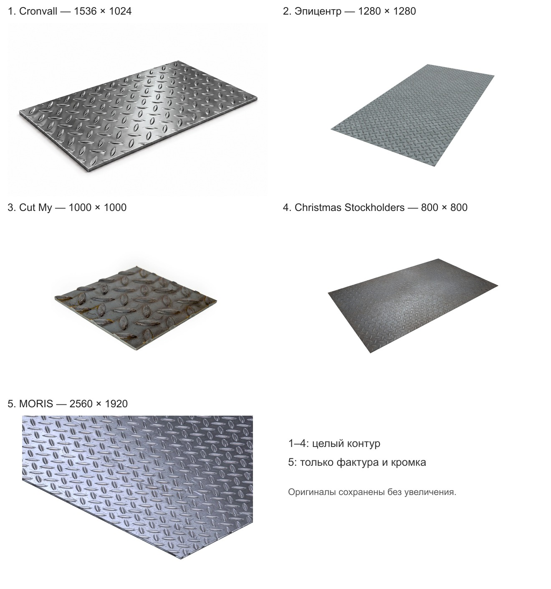

# Дополнительные изображения рифлёного стального листа

Подборка от 04.11.2026. Проверено 16 изображений; сохранены пять вариантов для выбора. К сайту не подключены, размерная разметка не добавлена.

| № | Источник | Размер файла в пикселях | Файл | Назначение |
| --- | --- | --- | --- | --- |
| 1 | [Cronvall](https://cronvall.de/variant/62908) | 1536 × 1024 | [01-cronvall-whole-sheet.png](01-cronvall-whole-sheet.png) | whole-sheet |
| 2 | [Эпицентр](https://epicentrk.ua/shop/mplc-list-stalevij-riflenij-garacekatanij-1500h1000-tovsina-4-0-mm-standart-s235jr-g-k-1-st-2604038147-1597-1f03196a-c169-6b1a-b482-9f34dc7a506d.html) | 1280 × 1280 | [02-epicentr-whole-sheet.jpg](02-epicentr-whole-sheet.jpg) | whole-sheet |
| 3 | [Cut My](https://www.cutmy.co.uk/metal/mild-steel/sheets/checker-plate/) | 1000 × 1000 | [03-cutmy-steel-sample.jpg](03-cutmy-steel-sample.jpg) | whole-sample |
| 4 | [Christmas Stockholders](https://www.christmas-steel.co.uk/steel/chequer-plate.html) | 800 × 800 | [04-christmas-steel-whole-sheet.png](04-christmas-steel-whole-sheet.png) | whole-sheet-backup |
| 5 | [MORIS](https://moris.eu/pl/product/SSHSHTPL31/blachy-cienkie-ryflowane) | 2560 × 1920 | [05-moris-surface-detail.webp](05-moris-surface-detail.webp) | surface-and-edge-detail |

1. **Cronvall.** Целый лист, белый фон, четыре края и выраженная толщина. По внешнему виду визуализация; источник прямо называет кадр символической иллюстрацией. Удобен для подписей длины, ширины и толщины, но не подтверждает фактуру поставляемой партии. Не называть документальной фотографией.

2. **Эпицентр.** Один целый лист на белом фоне, ровный ракурс для длины и ширины; рисунок хорошо различим. Толщина почти не видна, поэтому для её выносок слабее первого варианта. Карточка указывает стальной горячекатаный лист S235JR; числовые характеристики источника не переносить на наши позиции.

3. **Cut My.** Реальный вид небольшого стального образца: целый контур и передняя кромка на белом фоне. Рифли крупно, есть окалина и бурые следы окисления. Подходит для толщины и формы сечения, но не показывает пропорции целого длинного листа; менее аккуратен для основной карточки.

4. **Christmas Stockholders.** Целый тёмный стальной лист на белом фоне, без разметки и посторонних предметов. Ракурс удобен для длины и ширины. Резервный вариант: 800×800, фактура при увеличении уступает более крупным файлам.

5. **MORIS.** Крупный файл 2560×1920: фрагмент листа, чёткая фактура и передняя кромка на белом фоне. Для пояснения рифления и толщины, не для подписей полной длины и ширины: контур листа обрезан исходником. Источник относит карточку к стали S235JR/S235JR+N и предупреждает об иллюстративном характере изображения.

Для основной размерной карточки удобнее **№ 1**: целый контур и видимая толщина, но это иллюстрация. **№ 2** подходит для длины и ширины, **№ 5** — для фактуры и кромки. Если нужна именно документальная фотография, № 3 показывает поверхность реального образца, включая следы окисления.

Все файлы скопированы без изменения байтов. Разрешение не увеличивалось. В manifest.json записаны URL оригинальных доступных файлов, размеры, SHA-256, ограничения и причины исключения других кандидатов. Изображение MORIS имеет фактические размеры 2560 × 1920, несмотря на 2560Wx1440H в URL.

Из ранее найденных вариантов также сохранён [ATREON 1920 × 1080](../chequered-steel-sheet.jpg): его не заменяли. Для публикации размеры и масса берутся из наших конкретных товаров; совпадение рисунка рифления с поставкой требует подтверждения.
